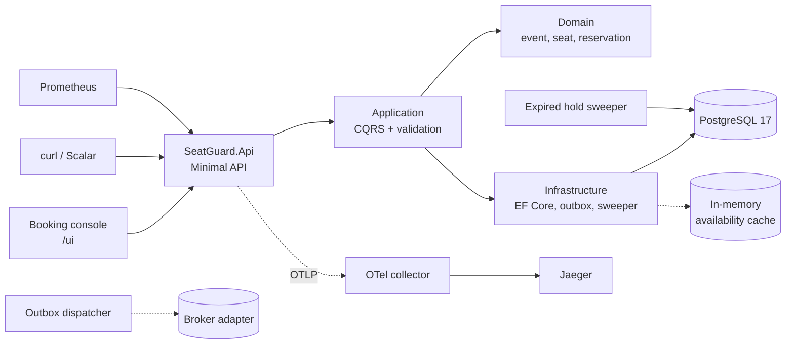
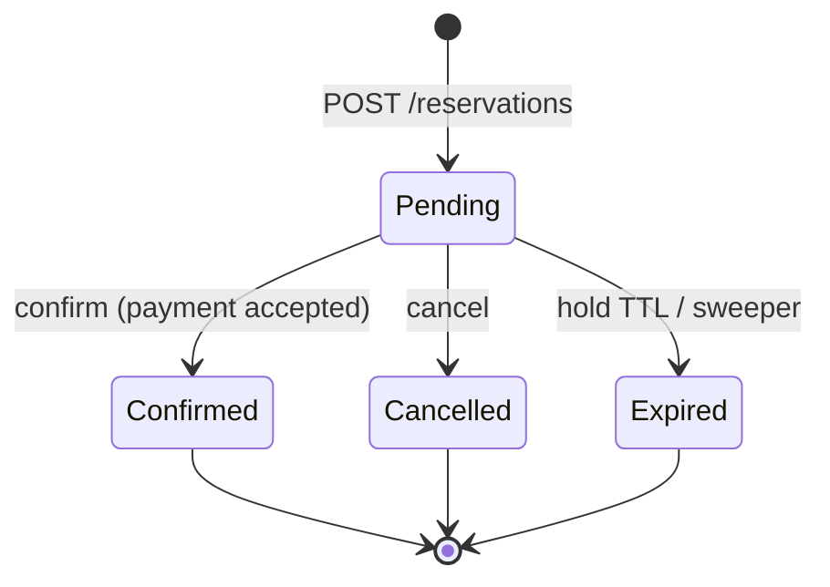
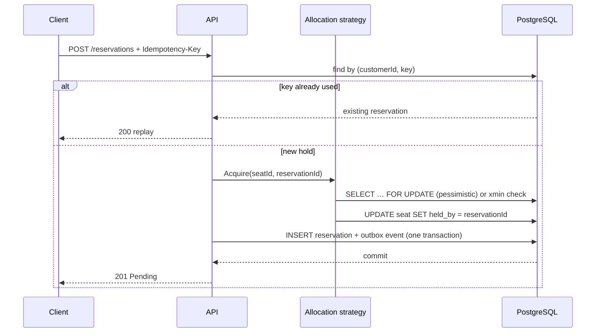

# SeatGuard

[](https://github.com/vitaly-sem/SeatGuard/actions/workflows/ci.yml)

Seat inventory and reservation service for ticketed events. The service owns the
seat map, allocates seats under contention, expires unpaid holds, and issues
tickets after a simulated payment. It is a single deployable .NET service backed
by PostgreSQL, with OpenTelemetry, Prometheus, health probes and Kubernetes
manifests.

The system is deliberately small in scope: no customer authentication, no real
payment provider, and no exactly-once messaging. Those boundaries are listed in
[Scope and limitations](#scope-and-limitations) together with the seams left for
extending them.

## Stack

| Area | Choice |
| --- | --- |
| Runtime | .NET 10, ASP.NET Core Minimal API |
| Data | PostgreSQL 17, EF Core, Npgsql |
| Messaging | Transactional outbox, pluggable `IIntegrationEventPublisher` |
| Telemetry | Serilog, OpenTelemetry (OTLP), Prometheus |
| Packaging | Multi-stage Docker image, Kustomize manifests, GitHub Actions |
| Tests | xUnit, Testcontainers, Respawn, `FakeTimeProvider` |

## Solution layout

| Project | Responsibility |
| --- | --- |
| `SeatGuard.Domain` | Aggregates (`Event`, `Seat`, `Reservation`), invariants, domain events, strongly typed ids |
| `SeatGuard.Application` | Use cases, ports, validation, transaction behaviour |
| `SeatGuard.Infrastructure` | EF Core mappings, PostgreSQL, allocation strategies, cache, outbox, sweeper, payments |
| `SeatGuard.Api` | Versioned endpoints, Problem Details, API-key auth, rate limiting, telemetry, `/ui` console |

```text
src/
  SeatGuard.Domain/           aggregates, events, ids
  SeatGuard.Application/      CQRS handlers, ports, behaviours
  SeatGuard.Infrastructure/   EF Core, strategies, outbox, sweeper
  SeatGuard.Api/              endpoints, auth, errors, wwwroot/ui
tests/
  SeatGuard.Domain.Tests/
  SeatGuard.Application.Tests/
  SeatGuard.IntegrationTests/
deploy/
  k8s/                        Kustomize base + dev/prod overlays
  observability/              OTel collector and Prometheus configs
docs/
  adr/                        architecture decision records
  screenshots/                console, create-event dialog, mobile layout
```

## Architecture



Requests enter through Minimal API endpoints, are dispatched as commands or
queries, and execute inside an explicit transaction when they mutate state. The
domain layer has no infrastructure dependencies; persistence concerns live behind
application ports implemented in `SeatGuard.Infrastructure`.

The booking console at `/ui` is static content served by the API. It calls the
same public endpoints as any other client, so there is no separate frontend
build, deployment or CORS configuration.

## Domain model and lifecycle

An `Event` owns sections and seats. A `Seat` is either `Available`, `Held` or
`Sold`. A `Reservation` tracks the hold and its outcome.



Invariants enforced in the aggregate:

- A hold can only be placed on an available seat.
- Only a `Pending` hold can be confirmed or cancelled; confirming an already
  confirmed reservation returns the existing ticket instead of failing.
- A hold expires at `ExpiresAt`; expired reservations cannot transition.
- A confirmed reservation owns a ticket code; cancellation releases the seat.
- Money is a decimal amount limited to two decimal places plus an ISO 4217
  currency code; different currencies cannot be combined.

## Reservation flow and idempotency

Hold creation accepts an optional customer-scoped `Idempotency-Key`. The pair
`(customer_id, idempotency_key)` is unique. A replay returns the original
reservation with `200 OK`; a new hold returns `201 Created`. The request is
keyed by customer so two customers cannot collide on the same key.



The key is stored on the reservation row and guarded by a partial unique index
on `(customer_id, idempotency_key)`, so the hold and its key commit atomically.
A sequential replay returns the stored reservation. A concurrent request that
loses the unique-constraint race receives `idempotency.key_in_progress` instead
of creating a second hold; retrying then returns the replay.

## Concurrency and seat allocation

Two strategies are selected with `Reservations:ConcurrencyStrategy`:

- **Pessimistic** (default) locks the seat row with `SELECT … FOR UPDATE`.
  Competitors queue, then observe `Held` and return a conflict. The behaviour is
  predictable under sustained contention, at the cost of lock waits.
- **Optimistic** reads without a lock and updates using PostgreSQL's `xmin`
  system column as a row version. A concurrent write raises a concurrency
  exception which the unit of work maps to a conflict; the request is not
  retried, because "the seat is taken" is a valid outcome rather than a
  transient failure. It is cheaper when collisions are rare.

Both strategies preserve the same visible contract: exactly one request wins a
seat and all others receive `seat.not_available` / `seat.conflict`.

`SKIP LOCKED` is intentionally not used on the reservation path. Skipping a
locked seat would turn a legitimate race into a false "not available". Contenders
queue on the row instead. `SKIP LOCKED` is reserved for the background jobs,
where the goal is to distribute work rather than order it.

Independently of the allocation strategy, PostgreSQL enforces the invariant:

```sql
CREATE UNIQUE INDEX ux_reservations_active_seat
    ON reservations (seat_id)
    WHERE status IN ('Pending', 'Confirmed');
```

A regression in application code therefore fails the transaction instead of
double-booking a seat.

## Expiry

Holds expire after `Reservations:HoldDuration` (10 minutes by default).
`ExpiredReservationSweeper` runs on `Reservations:SweeperInterval` and claims a
batch with `FOR UPDATE SKIP LOCKED`. For each candidate it re-checks ownership
and state, releases the seat, and writes a `ReservationExpired` outbox event in
the same transaction. A second sweep of the same batch returns zero, so replicas
can run the sweeper concurrently.

## Transactional outbox

Every aggregate change writes an outbox row in the same transaction as the state
change. `OutboxDispatcher` leases due rows with `FOR UPDATE SKIP LOCKED`, commits
the lease before publishing, then marks rows processed or schedules exponential
backoff up to `Outbox:MaxAttempts`. The lease-before-publish ordering means a
crash after publish causes redelivery, not loss; consumers must be idempotent.

Delivery is at-least-once. The default publisher writes a structured log entry;
replacing `IIntegrationEventPublisher` with a broker adapter is the intended
extension point. Processed rows are pruned after `Outbox:RetentionDays` by a
retention job that deletes in bounded batches.

## API

```bash
# Admin: create an event and generate its seats
EVENT_ID=$(curl -s -X POST http://localhost:5080/api/v1/events \
  -H 'Content-Type: application/json' \
  -H 'X-Api-Key: dev-admin-key' \
  -d '{
    "name": "Aurora Live",
    "venue": "Lumen Arena",
    "startsAt": "2026-12-19T19:00:00Z",
    "sections": [
      {"name": "Orchestra", "rows": 8, "seatsPerRow": 14, "priceAmount": 49, "currency": "EUR"},
      {"name": "Balcony",   "rows": 4, "seatsPerRow": 18, "priceAmount": 22, "currency": "EUR"}
    ]
  }' | jq -r .eventId)

# Public: availability (cached for two seconds)
curl -s "http://localhost:5080/api/v1/events/$EVENT_ID/availability" | jq

SEAT_ID=$(curl -s "http://localhost:5080/api/v1/events/$EVENT_ID/availability" \
  | jq -r '.seats[] | select(.status == "Available") | .id' | head -1)

# Hold a seat. Repeating this request with the same key returns the same hold.
RESERVATION_ID=$(curl -s -X POST http://localhost:5080/api/v1/reservations \
  -H 'Content-Type: application/json' \
  -H 'Idempotency-Key: 4f4b4d3a-6f7e-4f6a-9c5d-0a1b2c3d4e5f' \
  -d "{\"eventId\":\"$EVENT_ID\",\"seatId\":\"$SEAT_ID\",\"customerId\":\"customer-42\"}" \
  | jq -r .id)

# Charge the customer, issue a ticket
curl -s -X POST "http://localhost:5080/api/v1/reservations/$RESERVATION_ID/confirm" | jq
```

| Method | Route | Notes |
| --- | --- | --- |
| `POST` | `/api/v1/events` | Requires `X-Api-Key`; admin rate limit |
| `GET` | `/api/v1/events` | Paginated list |
| `GET` | `/api/v1/events/{id}` | Event and sections |
| `GET` | `/api/v1/events/{id}/availability` | Read model, `Cache-Control: private, max-age=10`, `ETag` |
| `POST` | `/api/v1/reservations` | Optional `Idempotency-Key`; 201 new, 200 replay |
| `GET` | `/api/v1/reservations/{id}` | Includes ticket code once confirmed |
| `POST` | `/api/v1/reservations/{id}/confirm` | Idempotent; charges then issues a ticket |
| `POST` | `/api/v1/reservations/{id}/cancel` | Releases a pending hold |

Errors use RFC 9457 Problem Details with stable codes such as
`seat.not_available`, `seat.conflict`, `reservation.expired`,
`reservation.invalid_state`, `idempotency.key_in_progress` and
`request.invalid`. Every response carries `X-Correlation-ID`, and the request log
records the same value.

Availability reads are served from a per-replica in-memory cache with a ten
second TTL that deliberately outlives the console's three second poll, so most
polls are cache hits. Mutations invalidate the entry in the process that served
it; other replicas converge within the TTL. The response also carries an `ETag`,
and conditional requests return `304 Not Modified` without serialising the seat
map again. This is a deliberate trade-off for a read-heavy seat map, not a
source of truth.

## Configuration

Standard ASP.NET Core configuration sources apply; environment variables use the
double-underscore form.

| Key | Default | Purpose |
| --- | --- | --- |
| `ConnectionStrings__SeatGuard` | `…Port=55432…` | PostgreSQL connection string |
| `Admin__ApiKey` | empty (locked) | `X-Api-Key` for event creation |
| `Reservations__HoldDuration` | `00:10:00` | Pending hold TTL |
| `Reservations__AvailabilityCacheTtl` | `00:00:10` | Availability cache TTL |
| `Reservations__SweeperInterval` | `00:00:15` | Sweeper poll interval |
| `Reservations__SweeperBatchSize` | `100` | Rows claimed per sweep |
| `Reservations__ConcurrencyStrategy` | `Pessimistic` | `Pessimistic` or `Optimistic` |
| `Reservations__SweeperEnabled` | `true` | Toggle the expiry worker |
| `Outbox__Enabled` | `true` | Toggle the dispatcher |
| `Outbox__PollInterval` | `00:00:05` | Dispatcher poll interval |
| `Outbox__BatchSize` | `50` | Rows leased per poll |
| `Outbox__LeaseDuration` | `00:00:30` | Lease before a row is retried |
| `Outbox__MaxAttempts` | `10` | Dead-letter threshold |
| `Outbox__CleanupEnabled` | `true` | Toggle retention cleanup |
| `Outbox__RetentionDays` | `7` | Days to keep processed rows; `0` disables cleanup |
| `Outbox__CleanupInterval` | `01:00:00` | How often retention runs |
| `Outbox__CleanupBatchSize` | `1000` | Rows deleted per statement |
| `Database__MigrateOnStartup` | `false` | Apply migrations at boot (dev/compose) |
| `Api__ExposeDocumentation` | `false` | Expose Scalar/OpenAPI outside Development |
| `Observability__Enabled` | `true` | Enable OTel instrumentation |
| `Observability__OtlpEndpoint` | empty | OTLP gRPC endpoint; empty disables export |
| `RateLimiting__BookingsPerMinute` | `120` | Per-IP booking requests |
| `RateLimiting__AdminPerMinute` | `30` | Per-key admin attempts (invalid keys are throttled too) |
| `RateLimiting__ReadsPerMinute` | `300` | Per-IP read requests |
| `ForwardedHeaders__Enabled` | `false` | Take the client IP from `X-Forwarded-For` behind a trusted proxy |
| `ForwardedHeaders__KnownProxies` | empty | Trusted proxy addresses (`__0`, `__1`, …) |
| `ForwardedHeaders__KnownNetworks` | empty | Trusted proxy CIDRs (`__0`, `__1`, …) |

Connection strings in the samples include `Gss Encryption Mode=Disable`: the
chiseled runtime does not ship the Kerberos library, and password authentication
does not need GSS encryption. Terminate TLS at PostgreSQL or a proxy in
production.

## Running locally

The compose stack runs PostgreSQL, the API, an OTel collector, Jaeger and
Prometheus. It sets `ASPNETCORE_ENVIRONMENT=Production`, applies migrations at
startup, enables Scalar/OpenAPI, and reads the admin key from `ADMIN_API_KEY`
(default `dev-admin-key`). The console pre-fills `dev-admin-key` only on
localhost.

```bash
# Port 55432 is bound by the stack. If a development PostgreSQL container
# already uses it, stop that container or override the published port first.
docker compose up --build
```

| Service | URL |
| --- | --- |
| Booking console | <http://localhost:5080/ui/> |
| API reference (Scalar) | <http://localhost:5080/scalar> |
| OpenAPI document | <http://localhost:5080/openapi/v1.json> |
| Jaeger | <http://localhost:16686> |
| Prometheus | <http://localhost:9090> |
| PostgreSQL | `localhost:55432` (`seatguard` / `seatguard`) |

Set `ADMIN_API_KEY` before exposing the stack anywhere; the default key is for
local use only.

```bash
docker compose down        # keep the database volume
docker compose down -v     # also delete data
```

### Local development

```bash
docker run --name seatguard-postgres-dev \
  -e POSTGRES_DB=seatguard -e POSTGRES_USER=seatguard -e POSTGRES_PASSWORD=seatguard \
  -p 55432:5432 -d postgres:17-alpine

dotnet run --project src/SeatGuard.Api --urls http://localhost:5080
```

Development applies migrations on startup and seeds nothing. `Admin__ApiKey` is
`dev-admin-key` in `appsettings.Development.json`.

## Testing

```bash
dotnet test SeatGuard.slnx
```

83 tests:

- **51 domain tests** for lifecycle invariants, money, ids and row labels.
- **16 application tests** for handlers, validation and behaviours.
- **16 integration tests** against real PostgreSQL in Testcontainers:
  lifecycle, idempotency, cache invalidation, both concurrency strategies,
  expiry through the sweeper, outbox retry/backoff and retention.

Integration tests use a frozen `FakeTimeProvider` for deterministic expiry and
Respawn to truncate tables between tests. The fixture configures early-read
settings through environment variables because `Program` reads them before a
`WebHostBuilder` configuration callback would apply.

Concurrency coverage is explicit: the suite fires 40 concurrent holds at one
seat for both allocation strategies and asserts one `201` and 39 conflicts.

## Observability

- **Logs**: Serilog compact JSON with service, environment, machine,
  `CorrelationId` and `TraceId`; request logs at Information, health/metrics at
  Debug.
- **Traces**: ASP.NET Core, HTTP client, EF Core and Npgsql sources exported over
  OTLP. Jaeger shows `seatguard-api` end to end.
- **Metrics**: `/metrics` for Prometheus, including
  `seatguard_reservations_created_total`, `confirmed`, `cancelled`, `expired`,
  `conflicts_total`, the reservation duration histogram, the in-flight gauge and
  `seatguard_outbox_purged_total`.
- **Health**: `/health/live` for liveness and `/health/ready` returning a JSON
  report per dependency. Readiness fails while migrations are pending.

## Deployment

Docker:

```bash
docker build -t seatguard-api:latest -f src/SeatGuard.Api/Dockerfile .
```

The runtime image is `aspnet:10.0-noble-chiseled-extra`, runs as UID 1654 and is
designed for a read-only root filesystem. The same image supports a
migration-only mode:

```bash
dotnet SeatGuard.Api.dll --migrate
```

Kubernetes manifests live in `deploy/k8s` and use a Kustomize base with dev and
prod overlays; see [deploy/k8s/README.md](deploy/k8s/README.md) for the resource
inventory, secret handling and upgrade procedure. CI
(`.github/workflows/ci.yml`) formats, builds, tests, validates rendered manifests
with kubeconform, then builds the container image exactly once, smoke-tests it
against PostgreSQL, scans that digest with Trivy and publishes the same digest
to GHCR (provenance and SBOM attached on pushes).
Dependabot tracks NuGet, actions and the base image.

## Design decisions

Architecture decision records document the reasoning behind the main choices,
including why the reservation path does not use `SKIP LOCKED`, why the outbox is
at-least-once, and why the console is served by the API instead of a separate
frontend build: [docs/adr](docs/adr/README.md).

## Scope and limitations

- Payments are simulated; `IPaymentGateway` is a seam for a real PSP. The
  confirm endpoint charges before issuing a ticket but does not reconcile
  asynchronous settlement.
- Customer authentication is out of scope; the API trusts `customerId`. Only
  administrative event creation is authenticated, with a shared API key.
- Availability caching is per replica and deliberately short (2 s). It is
  invalidated on every mutation in the process that served it.
- Outbox delivery is at-least-once. The default publisher logs events; a broker
  adapter is a drop-in replacement, but exactly-once delivery is not attempted.
- Optimistic allocation does not retry a lost update; under sustained contention
  the pessimistic strategy is the intended configuration.
