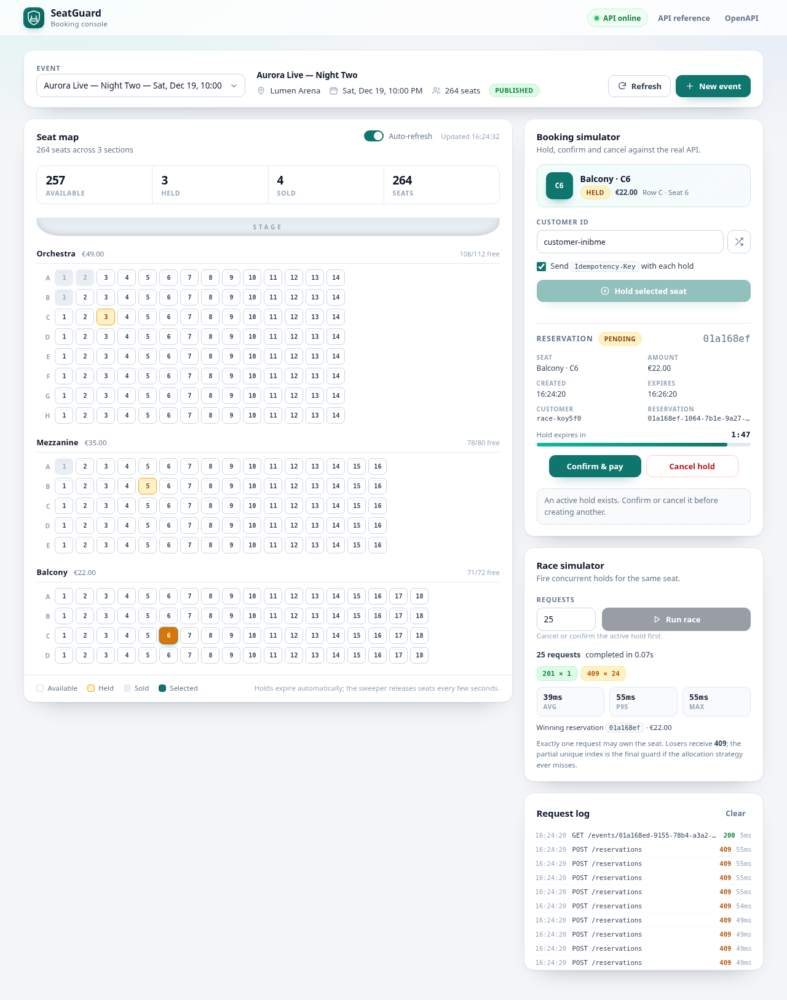
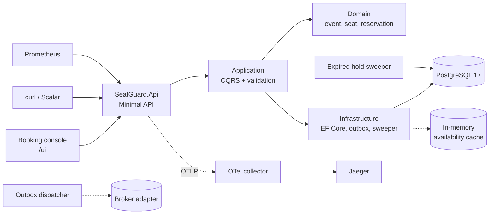
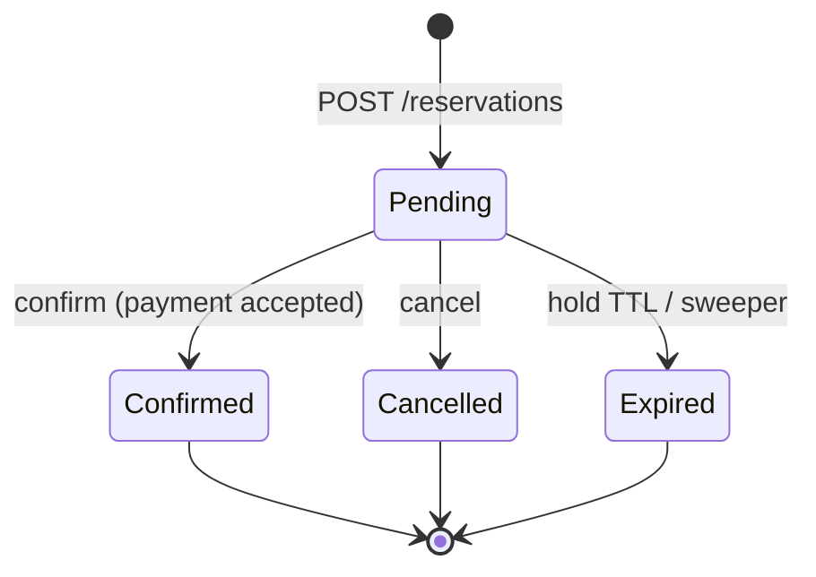
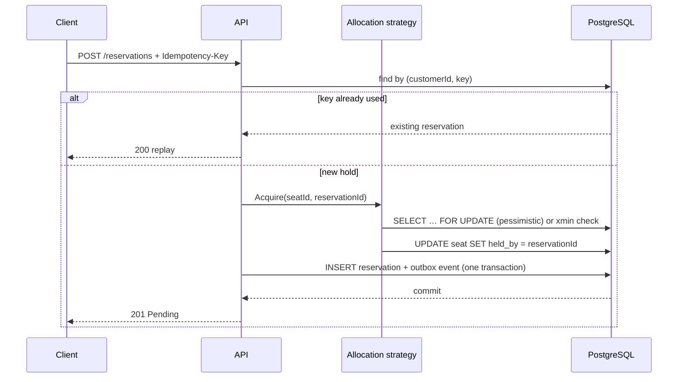

# SeatGuard

A concurrency-safe ticket booking API and operations console: reserve a seat,
hold it for a limited time, confirm it into a ticket, or let the sweeper return
it to inventory. Built with .NET 10, PostgreSQL 17, EF Core, OpenTelemetry and
Kubernetes-ready manifests.

The interesting part is not the CRUD. It is what happens when fifty people press
**Reserve** on the same seat at the same time.



## What it demonstrates

- **Exactly one winner per seat** under concurrent holds. Verified by integration
  tests for both a pessimistic (`SELECT … FOR UPDATE`) and an optimistic (`xmin`)
  allocation strategy.
- **A last line of defence in the database**: a partial unique index on active
  reservations per seat, so an application bug can never double-book.
- **Idempotent booking** with a customer-scoped `Idempotency-Key`; a replay
  returns the original reservation instead of creating another hold.
- **Expiring holds** released by a background sweeper using
  `FOR UPDATE SKIP LOCKED`, safe across replicas.
- **Transactional outbox** written in the same transaction as the aggregate and
  dispatched at least once with leases and exponential backoff.
- **A real UI** at `/ui` for inspecting seats, holding, confirming and
  simulating races without a separate frontend build.
- **Operational readiness**: structured logs, traces, Prometheus metrics,
  health probes, migration Job, HPA, PDB, NetworkPolicy and CI.

## Architecture



The solution is split into four projects:

| Project | Responsibility |
| --- | --- |
| `SeatGuard.Domain` | Aggregates, invariants, domain events, strongly typed ids |
| `SeatGuard.Application` | Use cases, ports, validation, transaction behaviour |
| `SeatGuard.Infrastructure` | EF Core, PostgreSQL, allocation strategies, outbox, sweeper |
| `SeatGuard.Api` | Versioned endpoints, Problem Details, auth, console, telemetry |

## Quick start with Docker

```bash
# If the development PostgreSQL container already owns port 55432, stop it first.
docker compose up --build
```

| Service | URL |
| --- | --- |
| Booking console | <http://localhost:5080/ui/> |
| API reference (Scalar) | <http://localhost:5080/scalar> |
| OpenAPI document | <http://localhost:5080/openapi/v1.json> |
| Jaeger | <http://localhost:16686> |
| Prometheus | <http://localhost:9090> |
| PostgreSQL | `localhost:55432` (`seatguard` / `seatguard`) |

The compose stack creates an event from the console: **New event** is prefilled
with the development admin key `dev-admin-key` on localhost. Set
`ADMIN_API_KEY` before exposing the stack anywhere, then enter that key in the
dialog.

```bash
docker compose down        # keep the database volume
docker compose down -v     # also delete data
```

### Local development

```bash
# PostgreSQL on the dedicated port used by appsettings.Development.json
docker run --name seatguard-postgres-dev \
  -e POSTGRES_DB=seatguard -e POSTGRES_USER=seatguard -e POSTGRES_PASSWORD=seatguard \
  -p 55432:5432 -d postgres:17-alpine

dotnet run --project src/SeatGuard.Api --urls http://localhost:5080
```

Development applies migrations on startup and seeds nothing: open `/ui/`, create
an event, pick a seat, and hold it.

## API

```bash
# Admin: create an event and generate its seats
EVENT_ID=$(curl -s -X POST http://localhost:5080/api/v1/events \
  -H 'Content-Type: application/json' \
  -H 'X-Api-Key: dev-admin-key' \
  -d '{
    "name": "Aurora Live",
    "venue": "Lumen Arena",
    "startsAt": "2026-12-19T19:00:00Z",
    "sections": [
      {"name": "Orchestra", "rows": 8, "seatsPerRow": 14, "priceAmount": 49, "currency": "EUR"},
      {"name": "Balcony",   "rows": 4, "seatsPerRow": 18, "priceAmount": 22, "currency": "EUR"}
    ]
  }' | jq -r .eventId)

# Public: availability (cached for two seconds)
curl -s "http://localhost:5080/api/v1/events/$EVENT_ID/availability" | jq

SEAT_ID=$(curl -s "http://localhost:5080/api/v1/events/$EVENT_ID/availability" \
  | jq -r '.seats[] | select(.status == "Available") | .id' | head -1)

# Hold a seat. Repeating this request with the same key returns the same hold.
RESERVATION_ID=$(curl -s -X POST http://localhost:5080/api/v1/reservations \
  -H 'Content-Type: application/json' \
  -H 'Idempotency-Key: 4f4b4d3a-6f7e-4f6a-9c5d-0a1b2c3d4e5f' \
  -d "{\"eventId\":\"$EVENT_ID\",\"seatId\":\"$SEAT_ID\",\"customerId\":\"customer-42\"}" \
  | jq -r .id)

# Charge the customer, issue a ticket
curl -s -X POST "http://localhost:5080/api/v1/reservations/$RESERVATION_ID/confirm" | jq
```

| Method | Route | Notes |
| --- | --- | --- |
| `POST` | `/api/v1/events` | Requires `X-Api-Key`; admin rate limit |
| `GET` | `/api/v1/events` | Paginated list |
| `GET` | `/api/v1/events/{id}` | Event and sections |
| `GET` | `/api/v1/events/{id}/availability` | Read model, `Cache-Control: private, max-age=2` |
| `POST` | `/api/v1/reservations` | Optional `Idempotency-Key`; 201 new, 200 replay |
| `GET` | `/api/v1/reservations/{id}` | Includes ticket code once confirmed |
| `POST` | `/api/v1/reservations/{id}/confirm` | Idempotent; charges then issues a ticket |
| `POST` | `/api/v1/reservations/{id}/cancel` | Releases a pending hold |

Errors use RFC 9457 Problem Details with stable codes such as
`seat.not_available`, `seat.conflict`, `reservation.expired`,
`reservation.invalid_state` and `request.invalid`. Every response carries
`X-Correlation-ID`.

### Reservation lifecycle





## Concurrency model

Two strategies are selected with `Reservations:ConcurrencyStrategy`:

- **Pessimistic** (default) locks the seat row with `SELECT … FOR UPDATE`, so
  competitors wait and then observe `Held`. It is the predictable choice under
  sustained contention.
- **Optimistic** reads without a lock and updates using the PostgreSQL `xmin`
  system column as a row version. It avoids lock waits and retries on conflict;
  it is cheaper when collisions are rare.

`SKIP LOCKED` is deliberately **not** used on the reservation path: skipping a
locked seat would turn a legitimate race into a spurious "not available".
Instead, contenders queue on the row. `SKIP LOCKED` is reserved for the two
background jobs, where the goal is to distribute work rather than order it.

Even if an allocation strategy regresses, PostgreSQL refuses a second active
reservation for a seat:

```sql
CREATE UNIQUE INDEX ux_reservations_active_seat
    ON reservations (seat_id)
    WHERE status IN ('Pending', 'Confirmed');
```

The integration suite fires 40 concurrent holds at one seat for **both**
strategies and asserts one 201 and 39 conflicts. The pre-container test run also
exercised 50 parallel requests through the real API with the same result.

## Expiry and outbox

- Holds expire after `Reservations:HoldDuration` (10 minutes by default).
  `ExpiredReservationSweeper` claims a batch with
  `FOR UPDATE SKIP LOCKED`, re-checks ownership, releases the seat and writes a
  `ReservationExpired` event in the same transaction. A second sweep returns 0.
- Every aggregate change writes an outbox row in the same transaction. The
  dispatcher leases due rows, commits the lease before publishing, then marks
  them processed or schedules exponential backoff. A crash after publish means
  redelivery: consumers must be idempotent. The default publisher writes a
  structured log; swap `IIntegrationEventPublisher` for a broker adapter.

## Configuration

| Key | Default | Purpose |
| --- | --- | --- |
| `ConnectionStrings__SeatGuard` | `…Port=55432…` | PostgreSQL connection string |
| `Admin__ApiKey` | empty (locked) | `X-Api-Key` for event creation |
| `Reservations__HoldDuration` | `00:10:00` | Pending hold TTL |
| `Reservations__ConcurrencyStrategy` | `Pessimistic` | `Pessimistic` or `Optimistic` |
| `Reservations__SweeperEnabled` | `true` | Toggle the expiry worker |
| `Outbox__Enabled` | `true` | Toggle the dispatcher |
| `Outbox__MaxAttempts` | `10` | Dead-letter threshold |
| `Database__MigrateOnStartup` | `false` | Apply migrations at boot (dev/compose) |
| `Api__ExposeDocumentation` | `false` | Expose Scalar/OpenAPI outside Development |
| `Observability__OtlpEndpoint` | empty | OTLP gRPC endpoint; empty disables export |
| `RateLimiting__BookingsPerMinute` | `120` | Per-IP booking requests |
| `RateLimiting__AdminPerMinute` | `30` | Per-IP admin requests |

Connection strings in the samples include `Gss Encryption Mode=Disable`: the
chiseled runtime does not ship the Kerberos library, and password authentication
does not need GSS encryption. Terminate TLS at PostgreSQL or a proxy in
production.

## Testing

```bash
dotnet test SeatGuard.slnx
```

82 tests:

- **51 domain tests** for lifecycle invariants, money, ids and row labels.
- **16 application tests** for handlers, validation and behaviours.
- **15 integration tests** against real PostgreSQL in Testcontainers:
  lifecycle, idempotency, cache invalidation, both concurrency strategies,
  expiry through the sweeper, and outbox retry/backoff. A frozen
  `FakeTimeProvider` drives time; Respawn truncates between tests.

The integration fixture configures early-read settings through environment
variables because `Program` reads them before a `WebHostBuilder` configuration
callback would apply.

## Observability

- **Logs**: Serilog compact JSON with service, environment, machine,
  `CorrelationId` and `TraceId`; request logs at Information, health/metrics at
  Debug.
- **Traces**: ASP.NET Core, HTTP client, EF Core and Npgsql sources exported over
  OTLP. Jaeger shows `seatguard-api` end to end.
- **Metrics**: `/metrics` for Prometheus, including
  `seatguard_reservations_created_total`, `confirmed`, `cancelled`, `expired`,
  `conflicts_total`, the reservation duration histogram and in-flight gauge.
- **Health**: `/health/live` for liveness and `/health/ready` returning a JSON
  report per dependency.

## Deployment

Docker:

```bash
docker build -t seatguard-api:latest -f src/SeatGuard.Api/Dockerfile .
```

The runtime is `aspnet:10.0-noble-chiseled-extra`, runs as UID 1654 with a
read-only root filesystem in Kubernetes, and supports a migration-only mode:

```bash
dotnet SeatGuard.Api.dll --migrate
```

Kubernetes manifests live in `deploy/k8s`; see
[deploy/k8s/README.md](deploy/k8s/README.md). CI
(`.github/workflows/ci.yml`) formats, builds, tests, validates rendered
manifests with kubeconform, scans the image with Trivy and publishes to GHCR on
`main`. Dependabot tracks NuGet, actions and the base image.

## Project layout

```text
src/
  SeatGuard.Domain/           aggregates, events, ids
  SeatGuard.Application/      CQRS handlers, ports, behaviours
  SeatGuard.Infrastructure/   EF Core, strategies, outbox, sweeper
  SeatGuard.Api/              endpoints, auth, errors, wwwroot/ui
tests/
  SeatGuard.Domain.Tests/
  SeatGuard.Application.Tests/
  SeatGuard.IntegrationTests/
deploy/
  k8s/                        Kustomize base + dev/prod overlays
  observability/              OTel collector and Prometheus configs
docs/
  adr/                        architecture decision records
  screenshots/                console, create-event dialog, mobile layout
```

## Design decisions

Architecture decision records explain the trade-offs, including why the
reservation path does not use `SKIP LOCKED`, why the outbox is at-least-once,
and why the console is served by the API instead of a separate frontend build:
[docs/adr](docs/adr/README.md).

## Known limitations

- Payments are simulated; `IPaymentGateway` is a seam for a real PSP.
- Customer authentication is out of scope; the API trusts `customerId`. Only
  administrative event creation is authenticated.
- Availability caching is per replica and deliberately short (2 s). It is
  invalidated on every mutation in the process that served it.
- The default publisher logs events. A broker adapter is a drop-in replacement,
  but exactly-once delivery is not attempted.
